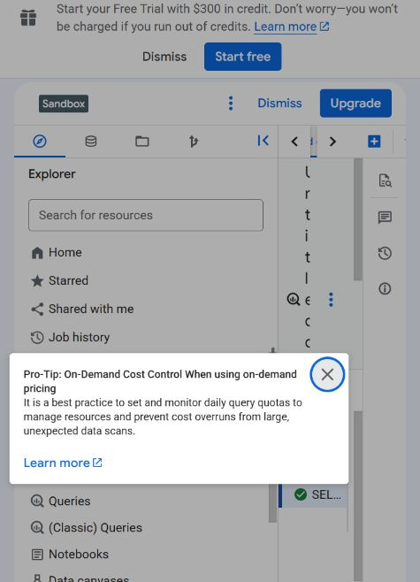
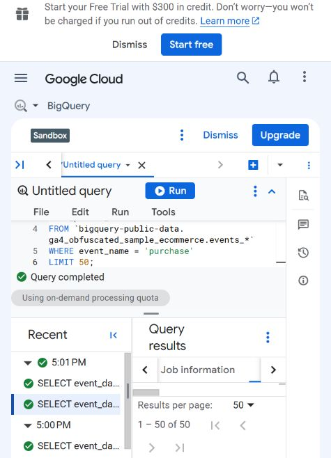
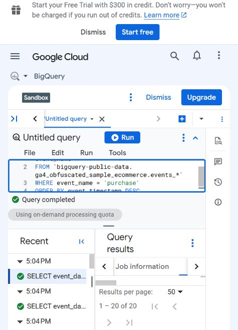
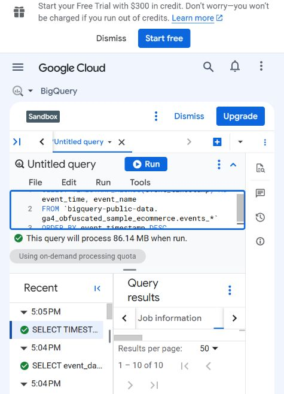
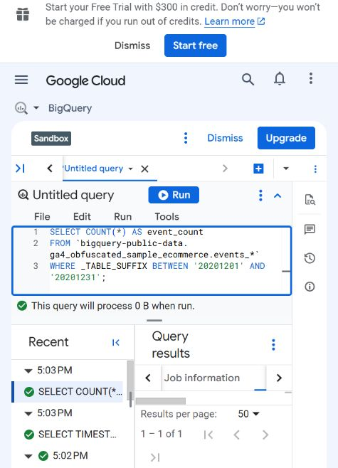
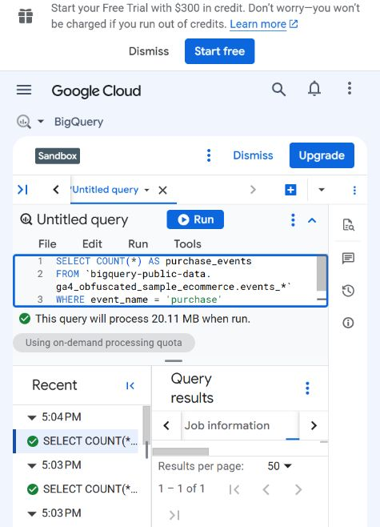
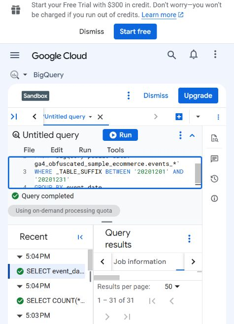
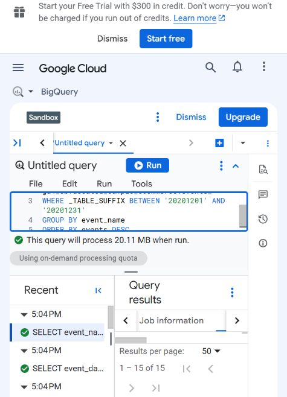
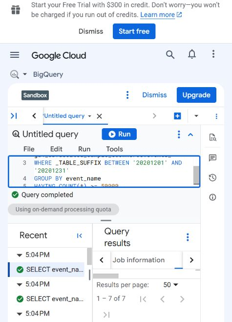
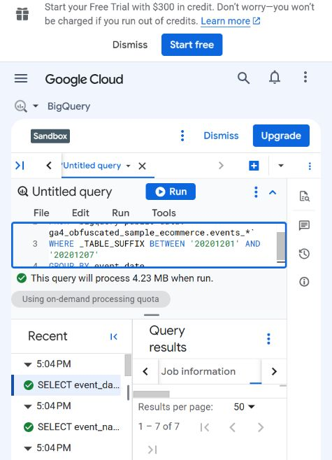

## Overview

This notebook practices the core BigQuery SQL clauses from Lecture 1 using the public Google Analytics 4 sample ecommerce dataset. The queries demonstrate how to inspect events, filter rows, sort results, summarize data, control the result grain, and limit wildcard-table scans by date.

The SQL blocks below are intentionally shown for documentation. They are not executed by Quarto. Each section includes a place for the screenshot of the corresponding BigQuery result.

Dataset used: `bigquery-public-data.ga4_obfuscated_sample_ecommerce.events_*`

## 1. Selecting columns and limiting rows

`SELECT` chooses the columns to return, `FROM` identifies the table, and `LIMIT` restricts the number of returned rows. This is a useful first inspection of the event data.

```sql
SELECT event_date, event_name
FROM `bigquery-public-data.ga4_obfuscated_sample_ecommerce.events_*`
LIMIT 20;
```



## 2. Filtering rows with `WHERE`

`WHERE` keeps only rows matching a condition. This query returns purchase events and includes the anonymous user identifier for each event.

```sql
SELECT event_date, event_name, user_pseudo_id
FROM `bigquery-public-data.ga4_obfuscated_sample_ecommerce.events_*`
WHERE event_name = 'purchase'
LIMIT 50;
```



## 3. Sorting with `ORDER BY`

`ORDER BY ... DESC` places the newest event timestamps first. The result is limited to 20 purchase events.

```sql
SELECT event_date, event_timestamp, event_name
FROM `bigquery-public-data.ga4_obfuscated_sample_ecommerce.events_*`
WHERE event_name = 'purchase'
ORDER BY event_timestamp DESC
LIMIT 20;
```



### Converting microseconds to a timestamp

GA4 `event_timestamp` values are stored in microseconds. `TIMESTAMP_MICROS` converts them into readable timestamp values.

```sql
SELECT
  TIMESTAMP_MICROS(event_timestamp) AS event_time,
  event_name
FROM `bigquery-public-data.ga4_obfuscated_sample_ecommerce.events_*`
ORDER BY event_timestamp DESC
LIMIT 10;
```



## 4. Aggregate functions

`COUNT(*)` reduces many event rows to one summary value. `_TABLE_SUFFIX` limits the wildcard table scan to December 1–31, 2020.

### Total events

```sql
SELECT COUNT(*) AS event_count
FROM `bigquery-public-data.ga4_obfuscated_sample_ecommerce.events_*`
WHERE _TABLE_SUFFIX BETWEEN '20201201' AND '20201231';
```



### Purchase events

Adding `event_name = 'purchase'` counts only purchase events in the same date range.

```sql
SELECT COUNT(*) AS purchase_events
FROM `bigquery-public-data.ga4_obfuscated_sample_ecommerce.events_*`
WHERE event_name = 'purchase'
  AND _TABLE_SUFFIX BETWEEN '20201201' AND '20201231';
```



## 5. Grouping results with `GROUP BY`

`GROUP BY` defines the grain of the result. In the first query, one output row represents one day.

### Events by day

```sql
SELECT
  event_date,
  COUNT(*) AS events
FROM `bigquery-public-data.ga4_obfuscated_sample_ecommerce.events_*`
WHERE _TABLE_SUFFIX BETWEEN '20201201' AND '20201231'
GROUP BY event_date
ORDER BY event_date;
```



### Top event types

Here, one output row represents one event type. Sorting by the aggregate alias makes the most frequent event types appear first.

```sql
SELECT
  event_name,
  COUNT(*) AS events
FROM `bigquery-public-data.ga4_obfuscated_sample_ecommerce.events_*`
WHERE _TABLE_SUFFIX BETWEEN '20201201' AND '20201231'
GROUP BY event_name
ORDER BY events DESC
LIMIT 15;
```



## 6. Filtering grouped results with `HAVING`

`HAVING` filters after aggregation. This query keeps only event types with at least 50,000 events.

```sql
SELECT
  event_name,
  COUNT(*) AS events
FROM `bigquery-public-data.ga4_obfuscated_sample_ecommerce.events_*`
WHERE _TABLE_SUFFIX BETWEEN '20201201' AND '20201231'
GROUP BY event_name
HAVING COUNT(*) >= 50000
ORDER BY events DESC;
```



## 7. Wildcard tables and `_TABLE_SUFFIX`

GA4 exports daily tables such as `events_20201201`. The wildcard `events_*` lets one query span multiple daily tables, while `_TABLE_SUFFIX` limits which dates are scanned. Restricting the scan improves efficiency and helps control query cost.

```sql
SELECT
  event_date,
  COUNT(*) AS events
FROM `bigquery-public-data.ga4_obfuscated_sample_ecommerce.events_*`
WHERE _TABLE_SUFFIX BETWEEN '20201201' AND '20201207'
GROUP BY event_date
ORDER BY event_date;
```



## Conclusion

The lecture builds from row-level inspection to aggregated analysis. The main pattern is to use `WHERE` before grouping to reduce the input rows, `GROUP BY` to define the reporting grain, and `HAVING` to filter the grouped results. For GA4 wildcard tables, `_TABLE_SUFFIX` is especially important because it controls the date range that BigQuery scans.

